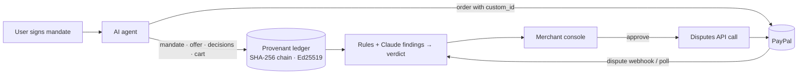
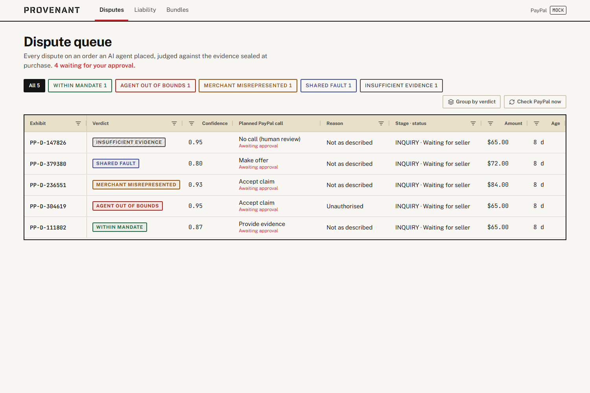
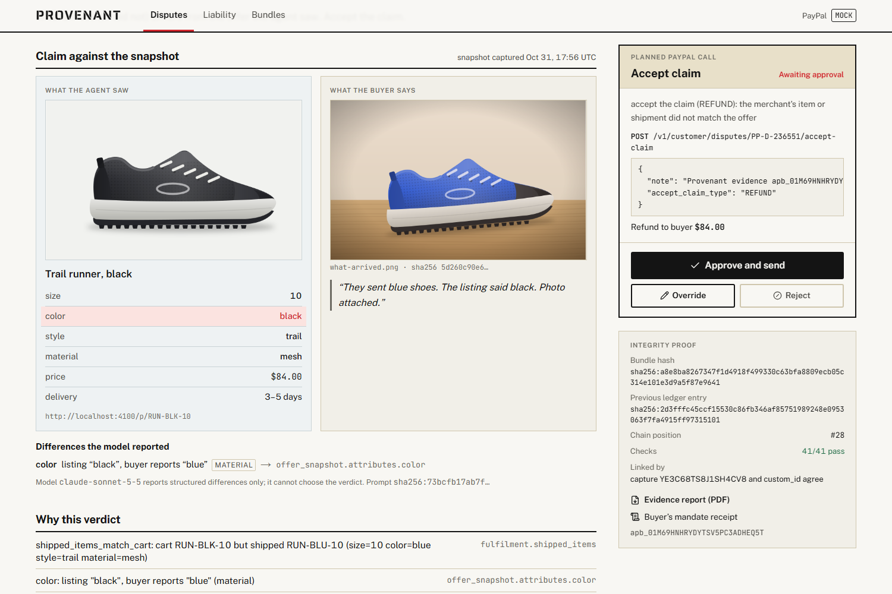
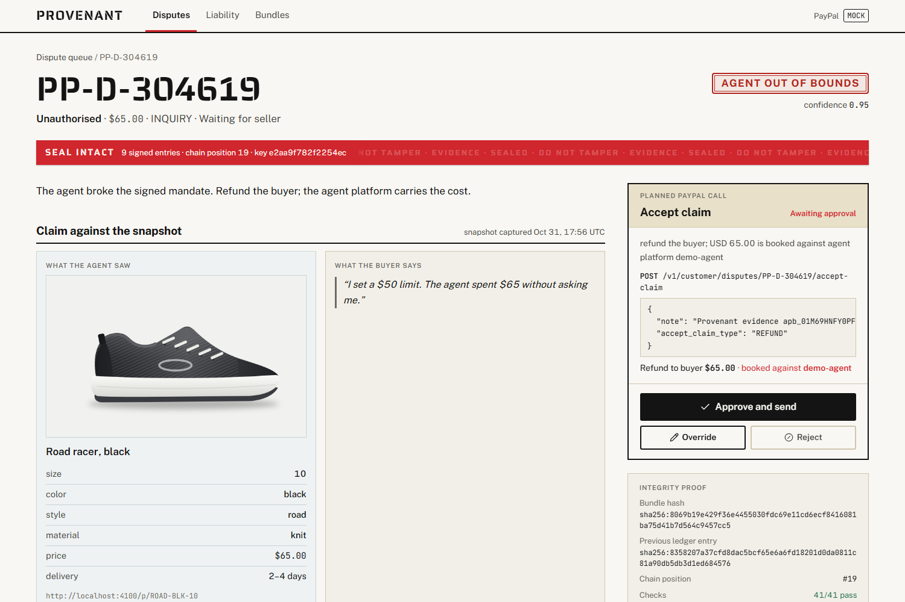
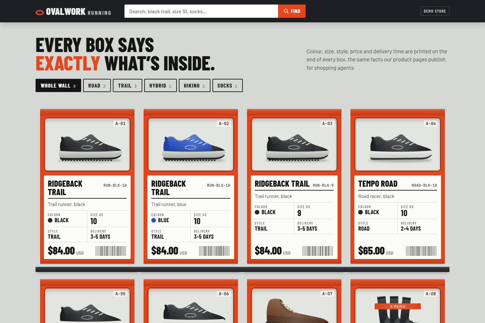

# Provenant

**Signed evidence and fair verdicts for disputes on purchases made by AI agents.**

When an AI shopping agent buys something and the buyer later disputes it, nobody can say who is at fault. Did the agent overstep what its user asked for? Did the merchant ship something other than what the agent saw? Or did the user just change their mind? Today the merchant eats the loss by default, because there is no record of what the user authorised or what the agent saw. Provenant closes that liability gap.

At purchase time it seals a signed, tamper-evident **evidence bundle** for every order an agent places through PayPal: the user's signed mandate, the approved cart, a snapshot of the offer (including the image), and the agent's decision trace. The bundle is linked to the PayPal order through `purchase_units[].custom_id`. When PayPal reports a dispute, Provenant judges the claim against the bundle, assigns fault with one of five verdicts, and, once the merchant approves, takes the matching action through the PayPal Disputes API.



| Dispute queue (AG Grid) | Wrong item: listing vs buyer photo, Claude's cited finding |
| --- | --- |
|  |  |
| **Agent out of bounds: the planned PayPal call** | **Demo store an agent buys from** |
|  |  |

Demo video: see the Devpost page. Script: [docs/demo-script.md](docs/demo-script.md). Submission answers: [docs/submission.md](docs/submission.md).

More detail: [docs/architecture.md](docs/architecture.md) · [docs/verdicts.md](docs/verdicts.md) · [docs/api.md](docs/api.md) · [PROGRESS.md](PROGRESS.md) (status and deviations from the spec).

## Quick start (no credentials, no Docker)

Requires Node 22+ and Git. Three commands:

```sh
corepack enable          # provides pnpm (pinned in package.json)
pnpm bootstrap           # install, .env, signing + API keys, embedded Postgres 16, migrations, seed
pnpm dev                 # API :4000 (OpenAPI at /docs) · console :3000 · demo store "Ovalwork Running" :4100
```

Then run the demo (in a second terminal, or on its own: it starts the stack when needed):

```sh
pnpm demo                # five agent purchases, five disputes, five verdicts, approved and settled
pnpm demo --no-approve   # same, but leaves the verdicts for you to approve in the console
```

From a fresh clone, `pnpm bootstrap && pnpm demo` is all it takes.

Open the console at http://localhost:3000. If port 3000 is busy, Next.js picks the next free port (for example 3001) and prints it in the `pnpm dev` output.

- Use `pnpm bootstrap` rather than `pnpm setup`: `setup` is a built-in pnpm command that modifies your PATH. The `setup` script exists too and can be run as `pnpm run setup`.
- Postgres starts embedded (data in `./data/pg`) unless something already answers at `DATABASE_URL`. To use Docker instead, run `docker compose -f infra/docker-compose.yml up -d` and set `DATABASE_MODE=external`.
- After closing a terminal without Ctrl+C, run `pnpm dev:stop`.
- On Windows, clone into a short path (for example `C:\src\provenant`). The embedded Postgres binaries sit deep inside `node_modules`, and paths over 260 characters fail to start unless Windows long paths are enabled.
- `pnpm demo` starts the stack itself when it is not already running, and keeps it up afterwards for the console.

## The five scenarios

`pnpm scenario <name>` runs one: mandate → purchase → fulfilment → dispute → verdict → approval → PayPal action → settlement.

| Scenario | What happens | Verdict | PayPal call | End state |
| --- | --- | --- | --- | --- |
| `remorse` | In-mandate purchase, delivered; buyer says they never wanted it | Within mandate | provide-evidence + PDF | settled for the seller |
| `overspend` | $50 cap, no confirmation; the agent buys a $65 pair | Agent out of bounds | accept-claim refund | refunded; $65 on the agent platform's liability |
| `wrong-item` | The listing showed black; the store's wrong-item switch ships blue; the buyer sends a photo | Merchant misrepresented | accept-claim refund | refunded |
| `ambiguous` | The mandate said "running shoes"; the listing said "trail/road hybrid"; the buyer wanted road | Shared fault | make-offer 50% | buyer accepts the partial refund |
| `tampered` | A sealed ledger row is edited directly in the database | Insufficient evidence | none | left for human review |

Shop as the agent yourself:

```sh
pnpm agent "black running shoes size 10 under $90, ask me above $50"
```

## Tools used

| Tool | Role |
| --- | --- |
| **PayPal** REST APIs (OAuth 2.0, Orders v2, Disputes v1, Webhooks) and the **PayPal Agent Toolkit** | Agent checkout with `custom_id`, capture, tracking, dispute intake and every dispute action. Details below. |
| **Claude Sonnet 5.5** (`claude-sonnet-5-5`) via the Anthropic API | Claim-vs-snapshot comparison in the adjudicator; mandate parsing and offer choice in the demo agent. See "What AI does". |
| **Model Context Protocol** | `packages/mcp-server` exposes Provenant to Claude Desktop and Claude Code |
| **AG Grid** Community (sponsor tool) | The console's dispute queue: filters, custom cell renderers, verdict grouping |
| **Postman** (sponsor tool) | `postman/` collection of the full flow, run with Newman (`pnpm postman`) |
| Fastify, Next.js, PostgreSQL 16, Drizzle, Zod, Vitest, Playwright, Turborepo | API, console, ledger, schemas, tests, build |
| Claude Code | Used while building, as a pair programmer for code, tests and docs |

Built during the PayPal AI Hackathon (first commit 16 October 2026; history in [PROGRESS.md](PROGRESS.md)).

## What AI does, and what it never does

- **The demo agent** can use Claude to turn the shopper's words into a mandate and to pick among offers. Code checks its pick: it must be one of the offers that passed the mandate checks.
- **The adjudicator** asks Claude for one thing only: a structured comparison of the buyer's claim, including photos, with the offer snapshot, including the image the agent saw. The output is schema-validated (`differences[]`, each citing a snapshot field), and any difference that cites no real field is dropped. Buyer text and images are sent as untrusted, escaped data blocks.
- **The model never decides the verdict, never moves money, and never calls PayPal.** Deterministic rules choose the verdict. If rules and model disagree, or confidence is low, the result is "insufficient evidence". No PayPal call is made until a merchant approves, unless you set `AUTO_ACTION=true`.
- **Provider and model.** `LLM_PROVIDER=anthropic` uses the Anthropic API (`@anthropic-ai/sdk`, structured outputs, server-side refusal fallback) with `LLM_MODEL` (default `claude-sonnet-5-5`). `LLM_PROVIDER=bedrock` uses Claude on Amazon Bedrock. The default, `mock`, is deterministic and offline. Every verdict stores the model id, prompt hash, inputs hash and raw output; `pnpm replay <verdictId>` re-runs it.

## How PayPal is used

| PayPal API | Used for | Docs |
| --- | --- | --- |
| OAuth 2.0 client credentials | Access tokens, cached and refreshed before expiry | [Authentication](https://developer.paypal.com/api/rest/authentication/) |
| Orders v2: create, PATCH, get, capture, track | Agent checkout with `purchase_units[0].custom_id` = bundle id; tracking after shipment | [Orders v2](https://developer.paypal.com/docs/api/orders/v2/) |
| Disputes v1: list (`update_time_after`), show details | Dispute mirror; HATEOAS links and `allowed_response_options` gate every action | [Disputes v1](https://developer.paypal.com/docs/api/customer-disputes/v1/) |
| Disputes v1: provide-evidence, provide-supporting-info, send-message, accept-claim, make-offer | The action matching the verdict (PDF attached as multipart) | [Use the Disputes API](https://developer.paypal.com/platforms/disputes/handle-disputes/use-disputes-api) |
| Disputes v1 sandbox: adjudicate, require-evidence | End-to-end settlement in sandbox | [Test and go live](https://developer.paypal.com/disputes/test-go-live) |
| Webhooks: `CUSTOMER.DISPUTE.CREATED/UPDATED/RESOLVED`, `PAYMENT.CAPTURE.COMPLETED`; verify-webhook-signature | Event intake, verified against PayPal with the raw body | [Webhooks](https://developer.paypal.com/api/rest/webhooks/rest/) · [Event names](https://developer.paypal.com/api/rest/webhooks/event-names/) |
| [PayPal Agent Toolkit](https://github.com/paypal/agent-toolkit) (`@paypal/agent-toolkit` 1.11) | The demo agent's `create_order` / `pay_order` tools in sandbox mode, wrapped so the order always carries the bundle's `custom_id` | |

Every POST sends `PayPal-Request-Id` (the same one on retries), and `PayPal-Partner-Attribution-Id` when `PAYPAL_BN_CODE` is set. 5xx and 429 responses are retried with backoff; other 4xx responses are never retried. Errors carry PayPal's `debug_id`.

## Sandbox mode

1. **App**: in the [Developer Dashboard](https://developer.paypal.com/dashboard/) switch to **Sandbox**, then **Apps & Credentials → Create App** (type *Merchant*, using your sandbox business account). Under **Features → Add-on services**, make sure **Customer disputes** is ticked.
2. **Accounts**: the sandbox has a business account (the merchant) and a personal account (the buyer). Get their logins under **Sandbox Accounts → ⋮ → View/Edit Account**.
3. **.env**: set `PAYPAL_MODE=sandbox`, `PAYPAL_CLIENT_ID` and `PAYPAL_CLIENT_SECRET`. Optionally set `PAYPAL_SANDBOX_BUYER_EMAIL` (the personal account's email).
4. **Check**: run `pnpm sandbox:check`. It creates an order with `custom_id`, PATCHes it, waits for you to approve it as the sandbox buyer, then captures, adds tracking and lists disputes.
5. **Agent purchase**: run `pnpm agent "…"`. In sandbox mode it uses the Agent Toolkit, prints PayPal's approval link, and continues once you have paid as the sandbox buyer.
6. **Receiving disputes**:
   - **Webhook**: run `cloudflared tunnel --url http://localhost:4000`. In the app's **Sandbox Webhooks**, add `https://<tunnel>.trycloudflare.com/webhooks/paypal`, subscribe to the four events above, and put the Webhook ID in `PAYPAL_WEBHOOK_ID`. Quick-tunnel URLs change on every run.
   - **Polling (no tunnel)**: the server checks every `DISPUTE_POLL_INTERVAL_SEC` (default 60s). "Check PayPal now" in the console, or `POST /v1/disputes/sync`, runs a pass immediately.
7. **Opening a dispute**: creating disputes through the API (`POST /v1/customer/disputes`) is a **limited-release** feature that needs the `DISPUTE_CREATE` scope from a PayPal account manager. Provenant tries it and, when PayPal refuses, says so. The dependable route is manual: log in to https://www.sandbox.paypal.com as the **personal** account, open the payment under Activity, and choose **Report a problem**. Polling or the webhook picks the dispute up. To settle it, approve the action in the console, then use the console's sandbox helpers (`/v1/disputes/:id/sandbox/adjudicate`).

## MCP server

Provenant exposes its tools to any MCP host over stdio: `create_bundle`, `record_offer`, `seal_order`, `get_evidence_bundle`, `verify_bundle`, `list_disputes`, `adjudicate_dispute`, `explain_verdict`. It reads the API URL and keys from the repo's `.env`, so run `pnpm bootstrap` and keep `pnpm dev` running.

**Claude Code:**

```sh
claude mcp add provenant -- npx tsx /absolute/path/to/provenant/packages/mcp-server/src/main.ts
```

**Claude Desktop** (`claude_desktop_config.json`):

```json
{
  "mcpServers": {
    "provenant": {
      "command": "npx",
      "args": ["tsx", "/absolute/path/to/provenant/packages/mcp-server/src/main.ts"]
    }
  }
}
```

Then ask, for example, "List my disputes and explain the overspend one."

## Tests and tooling

| Command | |
| --- | --- |
| `pnpm test` | All unit, integration and end-to-end suites (Vitest; real Postgres, one throwaway database per suite) |
| `pnpm test:e2e` | Playwright smoke test of the console (needs `pnpm dev`) |
| `pnpm postman` | The Postman collection with Newman against the running stack |
| `pnpm typecheck` · `pnpm lint` | TypeScript strict · Biome |
| `pnpm replay <verdictId>` | Re-run a stored verdict on its exact inputs |
| `pnpm openapi` | Regenerate `docs/openapi.json` |
| `pnpm keygen` · `pnpm db` · `pnpm db:migrate` · `pnpm db:stop` · `pnpm dev:stop` | Keys and database helpers |

## Repository layout

```
apps/      server · console · demo-agent · demo-store
packages/  schemas · evidence · db · config · paypal · llm · adjudicator · sdk · mcp-server
infra/     docker-compose.yml (optional Postgres) · render.yaml
scripts/   bootstrap, dev, keygen, replay, postman, openapi, sandbox check
postman/   collection + environment
docs/      architecture · verdicts · api · openapi.json
```

## Licence

[MIT](LICENSE)
