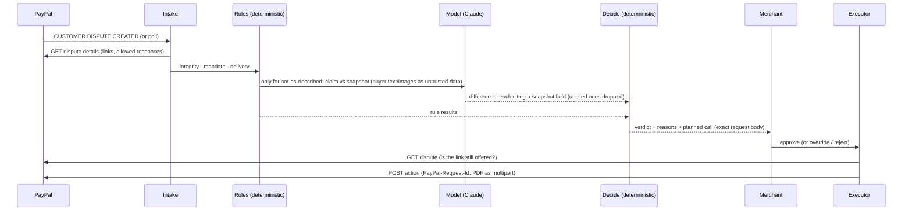

# Architecture

Provenant sits between an AI shopping agent, the merchant, and PayPal. At purchase time it seals what the agent was allowed to do and what it saw. When PayPal reports a dispute, it judges the claim against that record and, after the merchant approves, answers PayPal through the Disputes API.

```mermaid
flowchart LR
  subgraph Buyer side
    U[User<br/>signs mandate with own key]
    A[Shopping agent<br/>apps/demo-agent<br/>@provenant/sdk]
  end
  subgraph Merchant side
    S[Store<br/>apps/demo-store]
    C[Console<br/>apps/console]
  end
  subgraph Provenant API — apps/server
    B[Bundle API<br/>/v1/bundles]
    L[(Append-only ledger<br/>bundle_events<br/>SHA-256 chain + Ed25519)]
    I[Dispute intake<br/>webhooks + polling]
    J[Adjudicator<br/>rules → LLM findings → decide → plan]
    X[Action executor<br/>HATEOAS-gated]
    PDF[Evidence PDF]
  end
  P[(PayPal<br/>Orders v2 · Disputes v1 · Webhooks)]
  M[Claude<br/>structured findings only]

  U -- signed intent mandate --> A
  A -- mandate · offer snapshot · decisions · cart --> B --> L
  A -- create order<br/>custom_id = bundle id --> P
  A -- seal / capture sync --> B
  S -- fulfilment --> B
  P -- CUSTOMER.DISPUTE.* · PAYMENT.CAPTURE.COMPLETED --> I
  I -- list disputes · update_time_after --> P
  I --> J
  J -- claim vs snapshot --> M
  J --> PDF
  C -- approve / override / reject --> X
  X -- provide-evidence · accept-claim · make-offer · send-message · provide-supporting-info --> P
```

## Packages

| Package | Role |
| --- | --- |
| `packages/schemas` | Zod schemas shared everywhere: mandate, offer snapshot, cart, bundle, ledger events, verdicts, API requests |
| `packages/evidence` | Canonical JSON, SHA-256, Ed25519 (`node:crypto` only), the event reducer, the global hash chain, `verify`, content-addressed blob store, the evidence PDF |
| `packages/db` | Drizzle schema and migrations, embedded Postgres bootstrap, test databases |
| `packages/paypal` | `PayPalClient`; `HttpPayPal` (sandbox, OAuth, idempotency, retries, typed errors); `MockPayPal` (Postgres-backed lifecycle and webhooks) and its PayPal-shaped HTTP routes |
| `packages/llm` | `anthropic` / `bedrock` / `mock` providers returning schema-validated JSON |
| `packages/adjudicator` | Pure pipeline: integrity → mandate → delivery → claim vs snapshot → decide → plan |
| `packages/sdk` | `@provenant/sdk` for agent platforms, plus the Agent Toolkit `create_order` wrapper |
| `packages/mcp-server` | Provenant as MCP tools (stdio) |
| `apps/server` | Fastify API, webhook and polling intake, adjudication service, action executor |
| `apps/console` | Next.js merchant console (AG Grid queue, evidence-bag detail, liability, bundles) |
| `apps/demo-agent` | Shopping agent CLI and the five scripted scenarios |
| `apps/demo-store` | Demo merchant: catalogue, JSON-LD product pages, images, shipping desk |

## The evidence ledger

Every change to a bundle (created, offer recorded, decision, confirmation, cart, sealed, capture, fulfilment) is one row in `bundle_events`:

```
hash = sha256(canonical_json({ bundle_id, type, payload, prev_hash, created_at }))
sig  = ed25519_sign(provenant_key, hash)
prev_hash = hash of the previous row of the whole ledger
```

Appends take a Postgres advisory lock, so the chain is linear even under concurrency. `bundles` holds the materialised state for fast reads. `verify` replays the rows and checks:

- each hash recomputes and each signature verifies;
- each row links to its predecessor, and its successor links back;
- the replay equals the materialised row;
- the user's Ed25519 signatures on the mandate and on any confirmation verify;
- the offer image still matches its hash.

Editing, deleting or reordering a row, or editing the materialised bundle, breaks verification.

## Linking a dispute to its bundle

The agent creates the PayPal order with `purchase_units[0].custom_id` = bundle id. With PayPal's Agent Toolkit, whose `create_order` has no `custom_id`, `withProvenantCustomId` PATCHes it on right after creation. A dispute names the capture in `disputed_transactions[].seller_transaction_id` and carries the `custom_id` in `custom`. Provenant requires both to point at the same bundle. The capture itself is recorded only from PayPal's own data: the webhook, or `POST /v1/bundles/:id/capture`, which re-reads the order.

## Who decides what



The model never sees money, never returns a verdict, and never calls PayPal. Rules and model disagreeing, or low confidence, give `INSUFFICIENT_EVIDENCE`.

## Modes

| | Mock (default) | Sandbox |
| --- | --- | --- |
| PayPal | `MockPayPal` in the server, reachable at `/mock-paypal` with PayPal's paths | `HttpPayPal` → `api-m.sandbox.paypal.com` |
| Agent checkout | HttpPayPal → mock, mock buyer approves | PayPal Agent Toolkit `create_order` / `pay_order`; you approve in the browser |
| Disputes | mock buyer (`/_buyer/disputes`) | sandbox buyer in the PayPal UI (API creation is limited release) |
| Webhooks | delivered to `/webhooks/paypal` (signature check skipped) | tunnel + `PAYPAL_WEBHOOK_ID`, verified through PayPal; or polling |
| LLM | deterministic mock | `LLM_PROVIDER=anthropic` (Claude, structured outputs) or `bedrock` |
