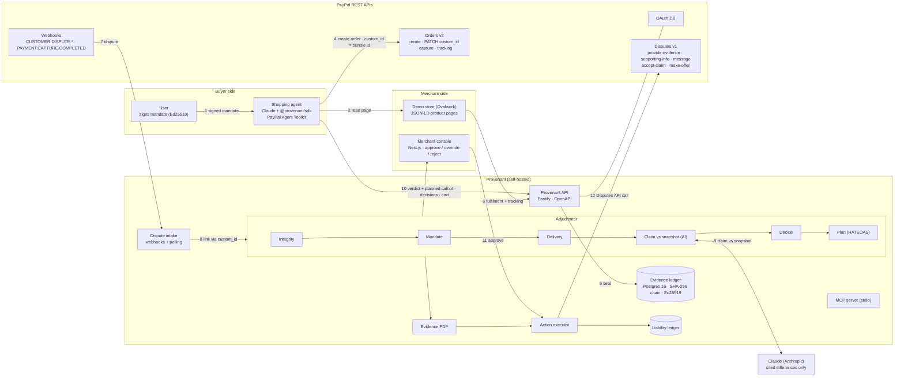

# Prompt: Provenant technical architecture diagram

Paste the prompt below into a diagramming-capable AI tool (Claude, Eraser.io's AI, Excalidraw AI, Lucid AI, draw.io with an assistant, or an image model) to get a technical architecture diagram for the deck and the Devpost page. Everything in it matches the code in this repository. A Mermaid version that renders as-is is at the end, as a fallback.

---

## The prompt

```text
Create a clean, technical system architecture diagram for "Provenant", a service that seals signed evidence for purchases made by AI shopping agents through PayPal, and later adjudicates disputes on those purchases. Landscape 16:9, readable on a projected slide.

LAYOUT: four vertical swim lanes, left to right:
  1. "Buyer side"
  2. "Provenant (self-hosted)"
  3. "PayPal (REST APIs)"
  4. "Merchant side"
Put Claude (Anthropic) as a separate box below the Provenant lane, connected only to the Adjudicator.

COMPONENTS:

Buyer side
- "User": signs an intent mandate with their own Ed25519 key (budget cap, categories, merchants, confirm-above threshold, expiry).
- "Shopping agent" (demo agent CLI): uses Claude to turn the request into a mandate and to choose among offers (code re-checks the choice). Uses @provenant/sdk and the PayPal Agent Toolkit (create_order / pay_order).

Provenant (self-hosted)
- "Provenant API": Fastify + TypeScript, OpenAPI docs, bearer API keys, rate limits.
- "Evidence ledger": PostgreSQL 16 append-only table of bundle events, each event signed (Ed25519), SHA-256 hash-chained (canonical JSON). Content-addressed blob store for snapshot images and buyer photos.
- "Dispute intake": PayPal webhooks (signature verified) plus polling fallback.
- "Adjudicator" pipeline, drawn as six small steps in a row:
  Integrity → Mandate rules → Delivery rules → Claim vs snapshot (AI) → Decide (deterministic) → Plan (HATEOAS-gated).
- "Action executor": calls the PayPal Disputes API only after merchant approval.
- "Evidence PDF" generator (attached to provide-evidence / provide-supporting-info).
- "Liability ledger": refunds booked against the agent platform when the agent broke the mandate.
- "MCP server" (stdio): exposes Provenant tools to Claude Desktop / Claude Code.

PayPal (REST APIs)
- "OAuth 2.0" (client credentials).
- "Orders v2": create, PATCH custom_id, capture, add tracking.
- "Disputes v1": list, show; provide-evidence, provide-supporting-info, send-message, accept-claim, make-offer.
- "Webhooks": CUSTOMER.DISPUTE.CREATED / UPDATED / RESOLVED, PAYMENT.CAPTURE.COMPLETED; verify-webhook-signature.

Merchant side
- "Demo store (Ovalwork Running)": product pages with schema.org JSON-LD and product images; shipping desk records fulfilment into Provenant.
- "Merchant console": Next.js; dispute queue, evidence detail, Approve / Override / Reject, liability, bundle explorer.

Claude (Anthropic), below Provenant
- "Claude (claude-sonnet-5-5)": structured outputs only. Label: "returns cited differences, never a verdict".

NUMBERED FLOWS (draw as arrows with small numbered circles, numbers in reading order):
 1. User → Shopping agent: signed mandate.
 2. Shopping agent → Demo store: read product page (JSON-LD + image).
 3. Shopping agent → Provenant API: mandate, offer snapshot, decisions, cart (bundle created).
 4. Shopping agent → PayPal Orders v2 (via Agent Toolkit): create order; then PATCH purchase_units[0].custom_id = bundle id.
 5. Provenant API → Evidence ledger: seal (signed, hash-chained events).
 6. PayPal → Provenant: capture synced; Demo store → Provenant: fulfilment + tracking.
 7. PayPal Webhooks → Dispute intake: dispute created (polling as fallback).
 8. Dispute intake → Adjudicator: dispute linked to bundle via custom_id and capture id.
 9. Adjudicator ↔ Claude: buyer claim and photos (as untrusted data) vs offer snapshot → cited differences.
10. Adjudicator → Merchant console: verdict + planned PayPal call with exact request body.
11. Merchant console → Action executor: Approve.
12. Action executor → PayPal Disputes v1: matching call (e.g. accept-claim REFUND, make-offer, provide-evidence + PDF).

LEGEND / CALLOUTS (small text boxes):
- "Five verdicts: Within mandate · Agent out of bounds · Merchant misrepresented · Shared fault · Insufficient evidence"
- "The model never decides the verdict and never moves money."
- "Any integrity failure → Insufficient evidence, no PayPal call."
- "Every POST: PayPal-Request-Id (idempotent), retries on 5xx/429, debug_id kept."
- "Mock PayPal and Sandbox behind one interface."

STYLE:
- White or very light grey background, dark ink text, thin 1.5px connectors, rounded-rectangle nodes with 4px corners.
- Colour by lane: buyer side neutral grey; Provenant deep green (#1f6b45) outlines; PayPal lane in neutral blue-grey (do NOT use PayPal's logo or brand colours); merchant side warm orange (#e5461b) outlines; Claude box in a muted terracotta outline with the label "Claude (Anthropic)".
- Sans-serif labels (Inter or similar), monospace for API paths and field names (e.g. purchase_units[0].custom_id).
- No 3D, no gradients, no drop shadows, no stock icons of people. Small line icons are fine (key for signature, chain link for ledger, scale for adjudicator, shield for integrity).
- Title at top left: "Provenant: architecture". Subtitle: "Signed evidence and fair verdicts for disputes on AI-agent purchases".
```

---

## Mermaid fallback

Renders in GitHub, Notion, mermaid.live, or VS Code.


